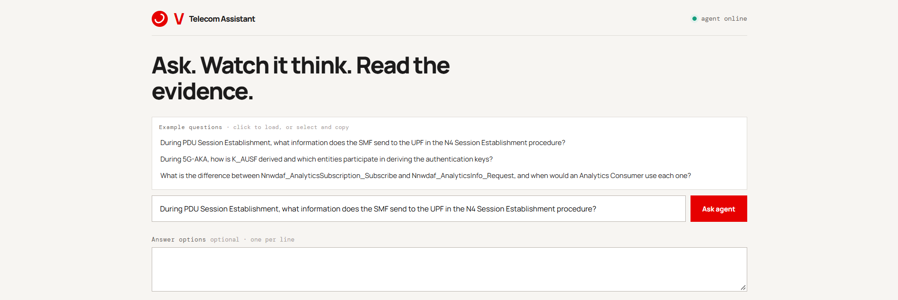
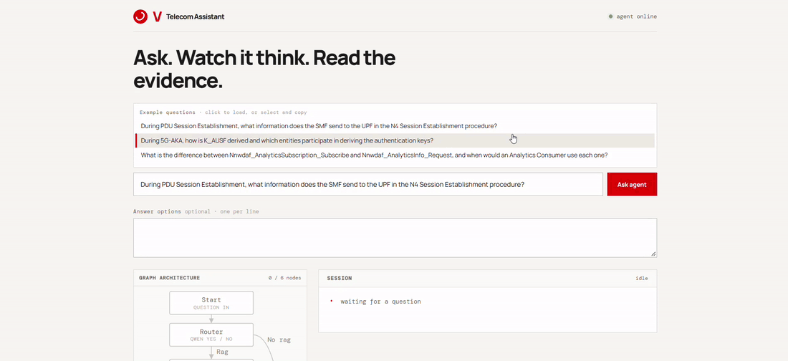
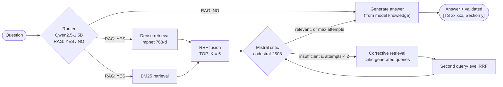
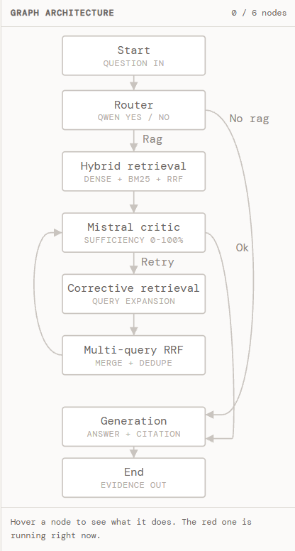

<div align="center">



# V Telecom Assistant

**A fine-tuned Qwen2.5-1.5B + agentic RAG assistant that answers telecom questions with citations pulled from real 3GPP specifications — and shows you exactly how it got there.**

[](https://www.python.org/)
[](https://pytorch.org/)
[](https://huggingface.co/Qwen/Qwen2.5-1.5B-Instruct)
[](https://github.com/huggingface/peft)
[](https://github.com/langchain-ai/langgraph)
[](https://www.trychroma.com/)
[](https://fastapi.tiangolo.com/)
[](https://developer.nvidia.com/cuda-toolkit)

</div>

---

## ▶ Watch it think

<div align="center">



<sub>A 30-second walkthrough · the UI streams every graph node, the retrieved 3GPP chunks, the critic verdict and the final citation.</sub>

</div>

---

## The 30-second pitch

Telecom engineers ask questions like *"Which network function provides Network Data Analytics services in the 5G System?"* The answer is buried in thousands of pages of 3GPP specs.

This project solves that end to end:

| Stage | What happens |
| --- | --- |
| **1. Parse** | 3GPP `.docx` specs → **6,302 structured sections** → **15,773 chunks** |
| **2. Embed** | Chunks indexed in ChromaDB with `multi-qa-mpnet-base-dot-v1` (768-d) |
| **3. Fine-tune** | Qwen2.5-1.5B-Instruct QLoRA-trained on **10,000 TeleQnA questions** |
| **4. Retrieve** | Hybrid **dense + BM25**, fused with reciprocal rank fusion (**RRF**) |
| **5. Critique** | Mistral `codestral-2508` grades retrieval and proposes better queries |
| **6. Correct** | Second retrieval round with critic-generated queries + query-level RRF |
| **7. Answer** | Local Qwen answers *from context only*; citations are validated, never invented |
| **8. Show** | A live web UI streams the whole graph, so you can audit every decision |

### Headline result

> **Fine-tuning lifted TeleQnA multiple-choice accuracy from 46.0% → 70.4%** on 1,000 held-out questions
> (**+24.4 points**, 295 questions fixed, 51 regressed) — with **no RAG, no retrieval, no critic**.
> That isolates the effect of the QLoRA fine-tune itself.

---

## How it works

The agent is a state machine. The router decides whether a question even needs 3GPP evidence; if it does, retrieval is graded by an external critic and corrected before generation is allowed.



<div align="center">

</div>

| Node | Responsibility | Guardrails |
| --- | --- | --- |
| `route` | Ask the fine-tuned model whether external evidence is required | Raw reply is surfaced so a surprising decision is debuggable |
| `retrieve` | Dense (`CANDIDATE_K=40`) + BM25 (`BM25_CANDIDATE_K=40`) → RRF (`RRF_K=60`) → top 5 | A `TS 23.502`-style spec number in the question restricts both retrieval arms |
| `evaluate_retrieval` | Mistral returns `{relevant, score, missing_information, search_queries}` | Structured, testable JSON |
| `prepare_retry` / `retrieve_retry` | Multi-query retrieval + a **second query-level RRF** | Hard cap: `MAX_RETRIEVAL_ATTEMPTS=2` |
| `generate` | Answer from retrieved context only | Citations must match retrieved metadata; otherwise the server attaches the top chunk as a fallback |

---

## The model

| | |
| --- | --- |
| Base model | [`Qwen/Qwen2.5-1.5B-Instruct`](https://huggingface.co/Qwen/Qwen2.5-1.5B-Instruct) |
| Method | **QLoRA** — 4-bit NF4, double quantization, bf16 compute |
| LoRA | `r=16`, `alpha=32`, `dropout=0.05`, targets `q_proj / k_proj / v_proj / o_proj` |
| Data | **10,000 TeleQnA** questions, 80 / 10 / 10 train / val / test |
| Training | 1 epoch, `lr=2e-4`, batch 8 × grad-accum 2, `max_length=512`, assistant-only loss |
| Framework | TRL `SFTTrainer`, PEFT, Transformers, PyTorch 2.8 + CUDA |
| Hardware | A single **4 GB** laptop GPU (NVIDIA RTX 3050) — the whole point of QLoRA |

### Fine-tuning results (no RAG)

| Held-out set | Base Qwen | + QLoRA | Δ | Fixed | Regressed |
| --- | ---: | ---: | ---: | ---: | ---: |
| **1,000 questions** | 46.0% | **70.4%** | **+24.4 pp** | 295 | 51 |
| 50 questions | 50.0% | 78.0% | +28.0 pp | 17 | 3 |

Median latency per answered question (1,000 set): **2.32 s → 1.99 s**.

> Results are exact multiple-choice option matches. Raw per-question outputs are in
> [`base_vs_finetuned_1000_results.csv`](base_vs_finetuned_1000_results.csv) and
> [`base_vs_finetuned_50_results.csv`](base_vs_finetuned_50_results.csv).

---

## What makes this demo different

Most RAG demos show you the answer. This one shows you the **work**.

- **Did it even use RAG?** The router output is displayed.
- **What exactly came back?** Every chunk is listed with its dense rank, BM25 rank, BM25 score, vector distance and fused score.
- **Was the context good enough?** The Mistral critic verdict and score are shown per round.
- **Did it retry?** The corrective branch and `new_chunks_vs_previous` are visible.
- **Where did the citation come from?** `model` vs `fallback` is labelled explicitly.

### It also reports its own weaknesses

These are measured behaviours, each guarded by a test — not hidden:

- **Router recall is the bottleneck.** On a labelled 8-need-RAG / 8-don't set, the fine-tuned router scores **75% accuracy at 100% precision but 50% recall** — it never over-retrieves, but it misses roughly half of the questions that should retrieve.
- **Multiple-choice leakage.** Fine-tuned on TeleQnA, the model still sometimes answers `option 1: ...` even though the prompt forbids it. Flagged as `multiple_choice_prefix`.
- **A rejected context can still produce a citation.** When the critic rejects a context but the model skips the required abstention, the server attaches the top chunk as a *locally derived* fallback citation. It cannot be a hallucination, but it points at evidence the critic just called insufficient. Flagged as `citation_attached_after_rejection`.

---

## Repository map

```text
3gpp_specs/
├── README.md                     ← you are here
├── assets/                       ← demo GIF + screenshots
├── demo/                         ← FastAPI + web UI agent showcase
│   ├── agent_server.py           ← LangGraph port of the notebook + telemetry
│   ├── index.html                ← the single-file UI
│   ├── test_demo.py              ← 16 checks (8 offline, 8 with an API key)
│   ├── run_demo.ps1
│   └── requirements.txt
├── notebooks/
│   ├── voda.ipynb                ← corpus build, retrieval, agent graph, RAGAS
│   └── LLM Fine Tuning Workflow.ipynb
├── Fine-tuning/
│   └── Untitled.ipynb            ← QLoRA training script (TeleQnA)
├── docs/
│   ├── architecture.md
│   ├── results.md
│   └── model-card.md
├── base_vs_finetuned_1000_results.csv
└── base_vs_finetuned_50_results.csv
```

> The notebooks contain absolute Windows paths (`C:\Users\...`). Update `ROOT_DIR`, `BASE_MODEL` and `DATA_FILE` for your machine.

---

## Quickstart

### Prerequisites

- Python **3.9+** and a CUDA-capable GPU (demo tested on a 4 GB RTX 3050)
- A **Mistral API key** (only the retrieval critic calls the network)
- The **base model** `Qwen/Qwen2.5-1.5B-Instruct` locally
- The **3GPP `.docx` specs** you want to index (from [3gpp.org](https://www.3gpp.org/))
- The **TeleQnA** dataset for fine-tuning

### 1 · Run the demo

```powershell
pip install -r demo/requirements.txt

# Point the server at your local resources (defaults shown)
$env:TELECOM_ROOT  = "C:\path\to\3gpp_specs"
$env:BASE_MODEL    = "C:\path\to\models\qwen2.5-1.5b"
$env:MISTRAL_API_KEY = "your-key"

cd demo
python -m uvicorn agent_server:app --host 127.0.0.1 --port 8000
# open http://127.0.0.1:8000
```

Or use the PowerShell wrapper:

```powershell
.\demo\run_demo.ps1 -MistralApiKey "your-key"
```

### 2 · Fine-tune the model

Open [`Fine-tuning/Untitled.ipynb`](Fine-tuning/Untitled.ipynb). It converts TeleQnA into chat format,
applies 4-bit quantization + LoRA, and writes the adapter to `./teleqna-qwen-1.5b-qlora`.

### 3 · Build the retrieval index

Open [`notebooks/voda.ipynb`](notebooks/voda.ipynb):

1. **Cells 0–1** — parse the 3GPP `.docx` files into sections, then chunks.
2. **Cell 2** — embed the chunks into the `3gpp_specs` Chroma collection.
3. **Cells 4+** — run the full agent, accuracy breakdowns and RAGAS evaluation.

---

## Configuration

| Constant | Value | Meaning |
| --- | --- | --- |
| `TOP_K` | 5 | Chunks passed to the generator |
| `CANDIDATE_K` | 40 | Dense candidates per round |
| `BM25_CANDIDATE_K` | 40 | BM25 candidates per round |
| `RRF_K` | 60 | Reciprocal rank fusion constant |
| `MAX_RETRIEVAL_ATTEMPTS` | 2 | Hard cap on corrective retrieval |
| `EMBEDDING_MODEL` | `multi-qa-mpnet-base-dot-v1` | Must match the index (768-d) |

---

## Tech stack

**Model & training** · Qwen2.5 · PEFT / QLoRA · TRL · Transformers · bitsandbytes · PyTorch
**Retrieval** · ChromaDB · sentence-transformers · rank-bm25 · reciprocal rank fusion
**Agent** · LangGraph · Mistral `codestral-2508` (retrieval critic)
**Serving** · FastAPI · Uvicorn · vanilla HTML/CSS/JS (no build step)

---

## Documentation

- [Architecture deep dive](docs/architecture.md)
- [Results & experiments](docs/results.md)
- [Model card](docs/model-card.md)
- [Demo notes](demo/README.md)

---

## Acknowledgements

- 3GPP specifications © ETSI / 3GPP
- [TeleQnA](https://github.com/netop-team/TeleQnA) benchmarking dataset
- [Qwen](https://github.com/QwenLM/Qwen2.5) by Alibaba Cloud
- [TRL](https://github.com/huggingface/trl), [PEFT](https://github.com/huggingface/peft), [LangGraph](https://github.com/langchain-ai/langgraph)

<div align="center"><sub>Built as an end-to-end showcase of fine-tuning + trustworthy retrieval over a real, messy, high-stakes domain.</sub></div>
